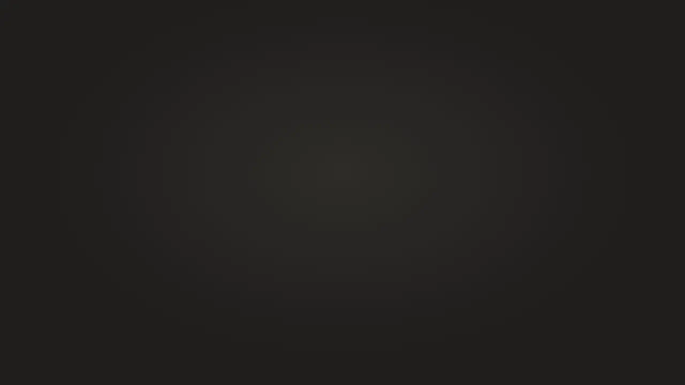
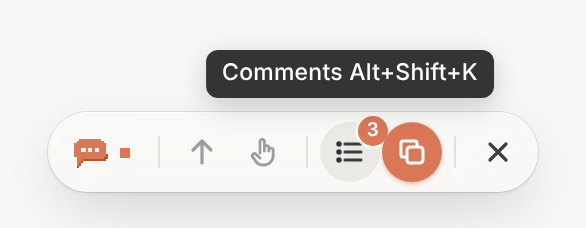
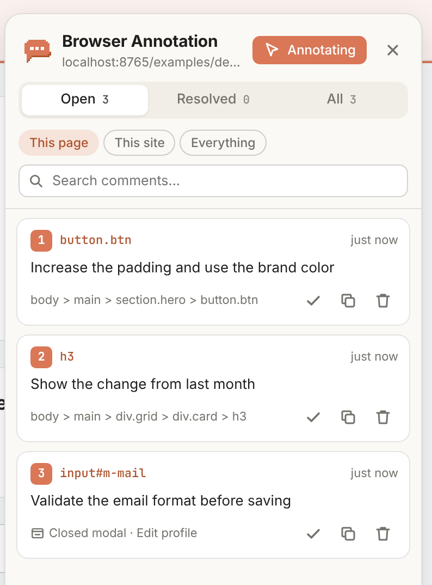

<div align="center">

**English** · [Português](README.pt-BR.md)


# Browser Annotation

**Comment right on the UI. Copy it to the AI. Done.**


A Chrome extension for developers: click any component on the page, leave a comment<br />
and copy every open request, with its code context, to paste into Claude, ChatGPT or Cursor.

<a href="docs/media/en/browser-annotation.mp4"></a>

<sub>🔊 <a href="docs/media/en/browser-annotation.mp4"><b>Click to watch with sound</b></a></sub>

</div>

## Why use it

- **No screenshots, arrows or "the blue button up top".** You point at the exact element.
- **Context the AI understands.** Every request carries the component, file:line, CSS selector and HTML.
- **Comments that don't get lost.** They stay attached to the component across reloads, page changes and code changes.
- **Free, open source and 100% local.** No account, no server, no telemetry.

## How to use

| Step | How |
| --- | --- |
| **1. Turn it on** | <kbd>⌘</kbd>/<kbd>Alt</kbd> + <kbd>⇧</kbd> + <kbd>E</kbd> or click the extension icon |
| **2. Comment** | Hover, click the element, write and save with <kbd>⌘</kbd>/<kbd>Ctrl</kbd> + <kbd>Enter</kbd> |
| **3. Copy** | Click the orange button on the bar and paste into your AI |

The comment stays attached to the component until you click **Resolve**.

## Installation

1. Download or clone this repository.
2. Open `chrome://extensions` and turn on **Developer mode**.
3. Click **Load unpacked** and pick the project folder.

Works on Chrome 111+ and should work on Chromium-based browsers (Edge, Brave, Arc).
The interface follows Chrome's language: Portuguese when Chrome is in Portuguese, English otherwise. The text copied to the AI uses the same language.
To try it quickly, open [`examples/demo.html`](examples/demo.html) through a local server (e.g. `python3 -m http.server`).

## Shortcuts

| Action | Shortcut |
| --- | --- |
| Turn annotation mode on/off | <kbd>⌘</kbd>/<kbd>Alt</kbd> + <kbd>⇧</kbd> + <kbd>E</kbd> |
| Annotate only while holding the key | hold <kbd>Alt</kbd> (<kbd>⌥</kbd> on Mac) |
| Use the page without commenting (open menus, modals, links) | hold <kbd>Ctrl</kbd> (<kbd>⌘</kbd> on Mac) |
| Select the parent element / back to the child | <kbd>↑</kbd> / <kbd>↓</kbd> |
| Save comment | <kbd>⌘</kbd>/<kbd>Ctrl</kbd> + <kbd>Enter</kbd> |
| Open the comment list | <kbd>⌘</kbd>/<kbd>Alt</kbd> + <kbd>⇧</kbd> + <kbd>K</kbd> |
| Close / exit | <kbd>Esc</kbd> |

In both main shortcuts, the first key is the one next to the space bar: <kbd>⌘</kbd> on Mac and <kbd>Alt</kbd> on Windows, Linux and ChromeOS. They use letters, so they don't depend on punctuation keys that move between keyboard layouts (such as Brazilian ABNT2). <kbd>E</kbd> and <kbd>K</kbd> are among the few letters free in these combinations in Chrome and in the operating systems (macOS, Windows, Linux and ChromeOS). To change them, open `chrome://extensions/shortcuts`: the extension's interface then shows the shortcut you picked.

> - On Windows, <kbd>Alt</kbd> + <kbd>⇧</kbd> alone switches the keyboard language when more than one is installed. Pressing the letter together usually doesn't trigger it.
> - If one of your programs already uses the combination (for example, i3 or sway with <kbd>Alt</kbd> as the main key), change the shortcut in `chrome://extensions/shortcuts`.
> - Had an earlier version installed? Chrome may keep the old shortcut; check `chrome://extensions/shortcuts`.

## Features

### Action bar



Shows up while annotation mode is on: mode indicator, shortcut hints, **comment list**, **copy open comments** and exit. Hover an icon to see what it does. It comes in three sizes (small, medium and large), chosen in the history settings.

### Comment list and history

<table>
<tr>
<td width="320"></td>
<td>

- **Open** and **resolved** comments, for the page, the site or everything.
- Search by text, component or URL.
- Click a comment to go to the element, even on another page.
- Resolve, reopen, copy just one or delete.
- The **History** button opens a page with every site, JSON export/import and settings.

</td>
</tr>
</table>

### Modals, sheets and popovers

<table>
<tr>
<td width="360"></td>
<td>

- Comment on elements inside modals, sheets and popovers **without them closing**.
- When the modal closes, the comment icon hides; when it opens again, the icon comes back.
- Hold <kbd>Ctrl</kbd> to open the modal without creating a comment.

</td>
</tr>
</table>

### The comment follows your code

If you change the component (text, classes, position), the extension finds the element again and updates the link. If it disappears for good, the icon shows a **?** at the original position: click **Pick element** to link the comment to the new element.

> **Tip:** components with a `data-testid` are found again almost every time.

## What gets copied

Ready-to-paste Markdown with the request and the clues to find the element in the code. Component and file:line show up in development builds of **React, Vue, Svelte and Angular**.

<details>
<summary>See an example</summary>

````markdown
## Page: Acme — http://localhost:3000/dashboard

### 1. Increase the padding and use the brand color

**Comment:**
> Increase the padding and use the brand color

**Where:**
- Component: `SaveButton` — `src/components/SaveButton.tsx:8:5` (React)
- Hierarchy: `App › Hero › SaveButton`
- Element: `<button class="btn">`
- Visible text: "Create report"
- Test id: `data-testid="cta-primary"`
- CSS selector: `[data-testid="cta-primary"]`
- DOM path: `body > main > section.hero > button.btn`
- HTML:
  ```html
  <button class="btn" data-testid="cta-primary">Create report</button>
  ```
````

</details>

<details>
<summary>How a comment stays linked to its element</summary>

Each comment stores the page (address without the query string or tracking parameters; hash routes like `#/route` count) and a "fingerprint" of the element: `data-testid`, stable `id`, CSS selector, XPath, tag, classes, text, component, position and, if any, the modal/sheet it was in.

When the page opens, candidates are scored against that fingerprint and the best one wins. If none fits, the extension looks for an element with the same tag and text near the original position. When the element is found again without ambiguity, the saved clues are updated, so gradual changes to the component don't break the link.

An option on the history page makes the query string count for the link.

</details>

## Privacy

- **Nothing leaves the browser:** no servers, no telemetry, no network requests. Comments live in `chrome.storage.local`.
- **Permissions:** `storage` (saving), `scripting` (tabs opened before installation), `contextMenus` (icon menu) and page access (showing the comments).
- The interface is isolated in a Shadow DOM, and text from the page or from imported files is never treated as HTML.

Found a security issue? Open an issue without sensitive details asking for a private contact.

## Contributing

Ideas, bugs and pull requests are welcome. The project is plain JavaScript with no build step: edit and click **Reload** in `chrome://extensions`.

```bash
npm install
```

```bash
npm test
```

The test loads the extension in a real Chromium and covers the main flow, in English and in Portuguese (`HEADED=1 npm test` shows the browser).

Interface texts live in [`_locales/en`](_locales/en/messages.json) and [`_locales/pt_BR`](_locales/pt_BR/messages.json): when you change or add a text, update both. The images and the video in this README are generated with the real extension, in both languages:

```bash
node scripts/screenshots.mjs
```

```bash
scripts/video/build.sh
```

Video details in [`scripts/video/README.md`](scripts/video/README.md).

<details>
<summary>Project structure</summary>

```
src/
  background/service-worker.js  icon click, shortcuts, badge, menu
  content/main.js               annotation mode, pins, popovers, panel
  content/locator.js            element fingerprint and re-finding
  content/page-bridge.js        component detection (React, Vue, Svelte, Angular)
  content/ui.js, styles.js      UI helpers and CSS (Shadow DOM)
  shared/                       storage, URLs, Markdown export, icons, translations helper
  history/                      history page
_locales/                       interface texts (en, pt_BR)
examples/                       test pages (demo.html in English, demo.pt-BR.html)
scripts/                        README images and video
tests/smoke.mjs                 end-to-end test (Playwright)
```

</details>

## Limitations

- Works in the main frame: the content of an `<iframe>` is annotated as the whole iframe.
- Elements inside web components' Shadow DOM are annotated through the component that contains them.
- Internal browser pages (`chrome://`, Chrome Web Store) don't accept extensions.
- Local files (`file://`) require turning on "Allow access to file URLs" in the extension details.
