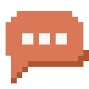
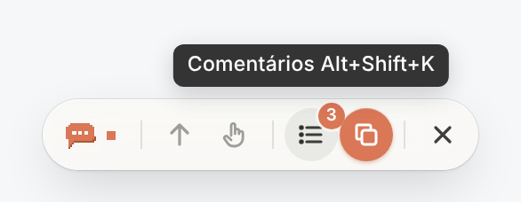
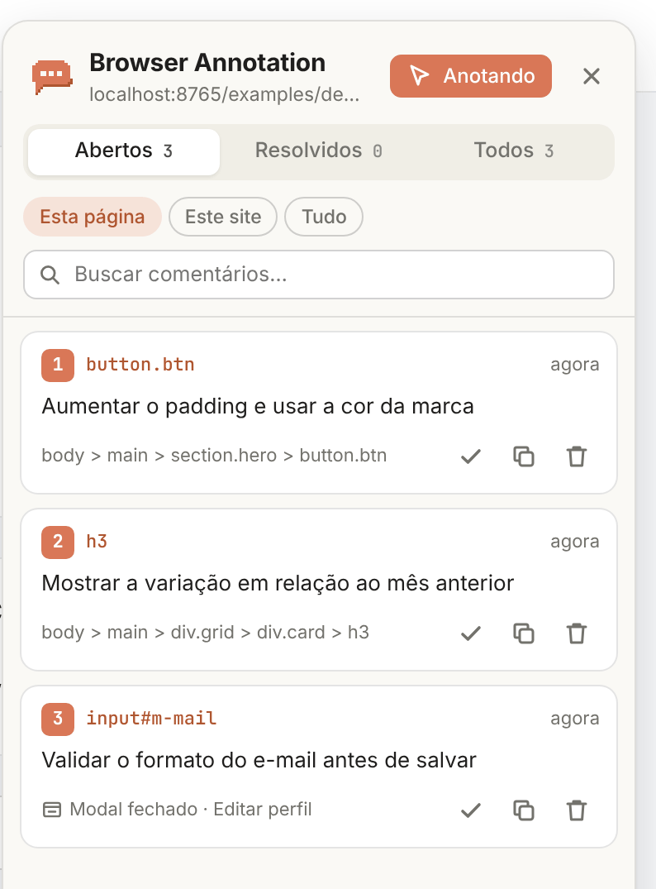
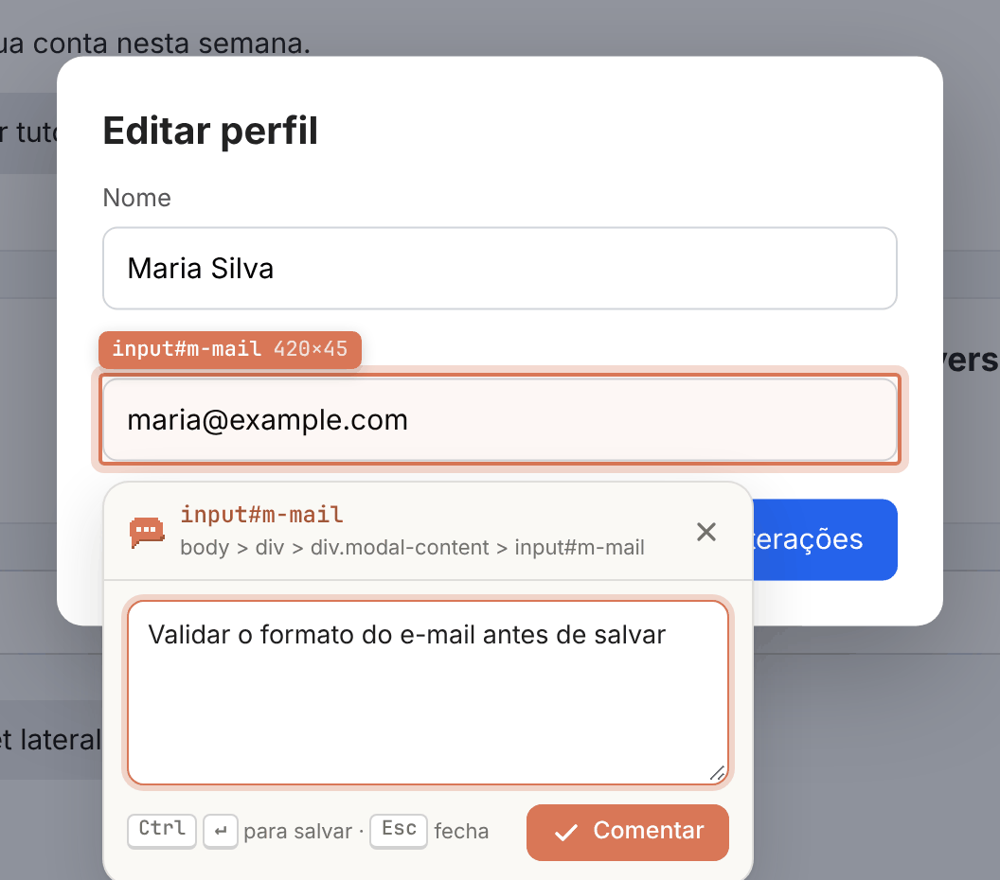

<div align="center">



# Browser Annotation

**Comente direto na interface. Copie para a IA. Pronto.**


Extensão do Chrome para devs: clique em qualquer componente da página, deixe um comentário<br />
e copie todos os pedidos em aberto, com o contexto do código, para colar no Claude, ChatGPT ou Cursor.

<a href="docs/media/browser-annotation.mp4"></a>

<sub>🔊 <a href="docs/media/browser-annotation.mp4"><b>Clique para ver com som</b></a></sub>

</div>

## Por que usar

- **Sem prints, setas ou "o botão azul lá em cima".** Você aponta o elemento exato.
- **Contexto que a IA entende.** Cada pedido vai com componente, arquivo:linha, seletor CSS e HTML.
- **Comentários que não se perdem.** Ficam presos ao componente entre reloads, trocas de página e mudanças no código.
- **Grátis, open source e 100% local.** Sem conta, sem servidor, sem telemetria.

## Como usar

| Passo | Como |
| --- | --- |
| **1. Ative** | <kbd>⌘</kbd>/<kbd>Ctrl</kbd> + <kbd>'</kbd> ou clique no ícone da extensão |
| **2. Comente** | Passe o mouse, clique no elemento, escreva e salve com <kbd>⌘</kbd>/<kbd>Ctrl</kbd> + <kbd>Enter</kbd> |
| **3. Copie** | Clique no botão laranja da barra e cole na sua IA |

O comentário fica preso ao componente até você clicar em **Resolver**.

## Instalação

1. Baixe ou clone este repositório.
2. Abra `chrome://extensions` e ative o **Modo do desenvolvedor**.
3. Clique em **Carregar sem compactação** e escolha a pasta do projeto.

Funciona no Chrome 111+ e deve funcionar em navegadores baseados em Chromium (Edge, Brave, Arc).
Para testar rápido, abra a página [`examples/demo.html`](examples/demo.html) por um servidor local (ex.: `python3 -m http.server`).

## Atalhos

| Ação | Atalho |
| --- | --- |
| Ligar/desligar o modo anotação | <kbd>⌘</kbd>/<kbd>Ctrl</kbd> + <kbd>'</kbd> |
| Anotar só enquanto segura a tecla | segure <kbd>Alt</kbd> (<kbd>⌥</kbd> no Mac) |
| Usar a página sem comentar (abrir menus, modais, links) | segure <kbd>Ctrl</kbd> (<kbd>⌘</kbd> no Mac) |
| Selecionar o elemento pai / voltar ao filho | <kbd>↑</kbd> / <kbd>↓</kbd> |
| Salvar comentário | <kbd>⌘</kbd>/<kbd>Ctrl</kbd> + <kbd>Enter</kbd> |
| Abrir a lista de comentários | <kbd>⌘</kbd>/<kbd>Ctrl</kbd> + <kbd>⇧</kbd> + <kbd>'</kbd> |
| Fechar / sair | <kbd>Esc</kbd> |

## Recursos

### Barra de ações



Aparece com o modo anotação ligado: indicador do modo, dicas de atalho, **lista de comentários**, **copiar abertos** e sair. Passe o mouse sobre um ícone para ver o que ele faz. Tem três tamanhos (pequena, média e grande), escolhidos nas configurações do histórico.

### Lista de comentários e histórico

<table>
<tr>
<td width="320"></td>
<td>

- Comentários **abertos** e **resolvidos**, da página, do site ou de tudo.
- Busca por texto, componente ou URL.
- Clique num comentário para ir até o elemento, mesmo em outra página.
- Resolver, reabrir, copiar um só ou excluir.
- O botão **Histórico** abre uma página com todos os sites, exportar/importar JSON e configurações.

</td>
</tr>
</table>

### Modais, sheets e popovers

<table>
<tr>
<td width="360"></td>
<td>

- Comente elementos dentro de modais, sheets e popovers **sem que eles fechem**.
- Quando o modal fecha, o ícone do comentário some; quando abre de novo, ele volta.
- Segure <kbd>Ctrl</kbd> para abrir o modal sem criar um comentário.

</td>
</tr>
</table>

### O comentário acompanha o código

Se você mudar o componente (texto, classes, posição), a extensão reencontra o elemento e atualiza o vínculo. Se ele sumir de vez, o ícone fica com um **?** na posição original: clique em **Escolher elemento** para vincular o comentário ao elemento novo.

> **Dica:** componentes com `data-testid` são reencontrados praticamente sempre.

## O que é copiado

Um Markdown pronto para colar, com o pedido e as pistas para achar o elemento no código. Componente e arquivo:linha aparecem em builds de desenvolvimento de **React, Vue, Svelte e Angular**.

<details>
<summary>Ver exemplo</summary>

````markdown
## Página: Acme — http://localhost:3000/dashboard

### 1. Aumentar o padding e usar a cor da marca

**Comentário:**
> Aumentar o padding e usar a cor da marca

**Onde:**
- Componente: `SaveButton` — `src/components/SaveButton.tsx:8:5` (React)
- Hierarquia: `App › Hero › SaveButton`
- Elemento: `<button class="btn">`
- Texto visível: "Criar relatório"
- Test id: `data-testid="cta-primary"`
- Seletor CSS: `[data-testid="cta-primary"]`
- Caminho no DOM: `body > main > section.hero > button.btn`
- HTML:
  ```html
  <button class="btn" data-testid="cta-primary">Criar relatório</button>
  ```
````

</details>

<details>
<summary>Como o comentário fica vinculado ao elemento</summary>

Cada comentário guarda a página (endereço sem query string e sem parâmetros de rastreamento; rotas em hash `#/rota` contam) e uma "impressão digital" do elemento: `data-testid`, `id` estável, seletor CSS, XPath, tag, classes, texto, componente, posição e, se houver, o modal/sheet onde ele estava.

Ao abrir a página, os candidatos recebem uma pontuação contra essa impressão digital e o melhor é escolhido. Se nenhum servir, a extensão procura um elemento da mesma tag com o mesmo texto perto da posição original. Quando o elemento é reencontrado sem ambiguidade, as pistas salvas são atualizadas, então mudanças graduais no componente não quebram o vínculo.

A query string pode passar a contar no vínculo com uma opção na página de histórico.

</details>

## Privacidade

- **Nada sai do navegador:** sem servidores, sem telemetria, sem requisições de rede. Os comentários ficam no `chrome.storage.local`.
- **Permissões:** `storage` (salvar), `scripting` (abas abertas antes da instalação), `contextMenus` (menu do ícone) e acesso às páginas (mostrar os comentários).
- A interface fica isolada num Shadow DOM, e textos da página ou de arquivos importados nunca são tratados como HTML.

Encontrou um problema de segurança? Abra uma issue sem detalhes sensíveis pedindo um contato privado.

## Contribuindo

Ideias, bugs e pull requests são bem-vindos. O projeto é JavaScript puro, sem etapa de build: edite e clique em **Recarregar** em `chrome://extensions`.

```bash
npm install
```

```bash
npm test
```

O teste carrega a extensão num Chromium real e cobre o fluxo principal (`HEADED=1 npm test` mostra o navegador).

<details>
<summary>Estrutura do projeto</summary>

```
src/
  background/service-worker.js  clique no ícone, atalho, badge, menu
  content/main.js               modo anotação, pins, popovers, painel
  content/locator.js            impressão digital e reencontro do elemento
  content/page-bridge.js        detecção de componentes (React, Vue, Svelte, Angular)
  content/ui.js, styles.js      helpers de interface e CSS (Shadow DOM)
  shared/                       storage, URLs, exportação Markdown, ícones
  history/                      página de histórico
examples/demo.html              página para testar
tests/smoke.mjs                 teste end-to-end (Playwright)
```

</details>

## Limitações

- Funciona no frame principal: o conteúdo de um `<iframe>` é anotado como o iframe inteiro.
- Elementos dentro de Shadow DOM de web components são anotados pelo componente que os contém.
- Páginas internas do navegador (`chrome://`, Chrome Web Store) não aceitam extensões.
- Arquivos locais (`file://`) exigem ativar "Permitir acesso a URLs de arquivo" nos detalhes da extensão.
